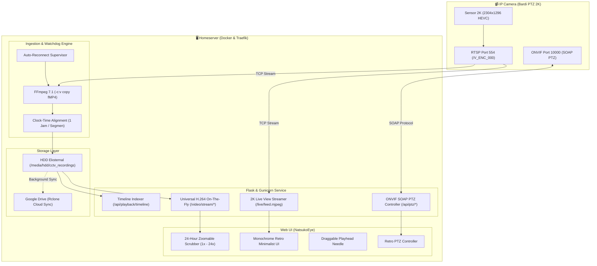

# 👁️ NatsukoEye — Autonomous 2K NVR & Retro Timeline Hub

[](https://www.docker.com/)
[](https://www.python.org/)
[](https://ffmpeg.org/)
[-black)](#)
[](#)
[-blue)](#)

**NatsukoEye** adalah sistem Network Video Recorder (NVR) mandiri (*autonomous*) berkinerja tinggi yang dirancang khusus untuk merekam, memantau, dan memutar rekaman kamera CCTV IP/PTZ (seperti Bardi PTZ 2K) secara berkesinambungan 24/7 tanpa henti.

Dilengkapi antarmuka **Monochrome Retro Minimalist** yang responsif di desktop maupun smartphone, fitur **Scrubber Timeline 24 Jam** yang dapat diperbesar/perkecil (*zoomable 1x–24x*), jarum penunjuk waktu taktil yang dapat digeser bebas (*draggable playhead*), serta pemutaran antar jam yang bersambung otomatis (*seamless continuous rollover*).

---

## ✨ Fitur Utama

- **🔒 Sistem Pasti Rekam 24/7 (Autonomous Watchdog)**: Perekam FFmpeg 7.1 bekerja dengan supervisor independen. Setiap kali konfigurasi kamera disimpan, sistem langsung merekam otomatis ke HDD eksternal tanpa tombol *start/stop* manual yang rawan kelupaan.
- **💎 Kualitas Murni 2K Super HD (2304×1296)**: Perekaman menggunakan *Direct Bit-for-bit Stream Copy* (`-c:v copy`) dari sensor H.265/HEVC tanpa kompresi ulang (*zero quality loss*).
- **📼 Interactive 24-Hour Timeline Scrubber**:
  - Visualisasi track waktu 24 jam penuh (00:00 – 24:00) dengan blok hitam kontras yang menandai ketersediaan rekaman.
  - **Skala Zoom Fleksibel**: Pilihan zoom cepat `24 JAM (1x)`, `12 JAM (2x)`, `6 JAM (4x)`, `2 JAM (12x)`, dan `1 JAM (24x)` untuk navigasi detik demi detik.
  - **Jarum Taktil Draggable**: Jarum merah penunjuk waktu dilengkapi *grip handle* retro yang dapat digeser langsung dengan mouse atau sentuhan jari di layar HP.
  - **Auto-Rollover Antar Jam**: Saat segmen 1 jam selesai diputar, video otomatis menyambung ke rekaman jam berikutnya tanpa jeda.
- **🔴 Real-Time 2K Live View & PTZ D-Pad**: Pemantauan langsung beresolusi 2K 1296p dengan kontrol arah PTZ (Pan, Tilt, Stop) via ONVIF SOAP port 10000.
- **📱 100% Mobile Responsive & Touch-Scrubbing**: D-Pad berukuran besar ramah sentuhan, tata letak kontrol 2-baris di HP, dan navigasi ramah jempol.
- **⏰ Zona Waktu WIB (UTC+7)**: Seluruh penamaan file (`bardi_YYYY-MM-DD_HH-MM-SS.mp4`), jam live view, timeline, dan data arsip tersinkronisasi presisi dengan Waktu Indonesia Barat.
- **💾 Penyimpanan Hibrida HDD + Cloud Sync**:
  - Rekaman primer tersimpan di HDD lokal eksternal (misal: `/media/hdd/cctv_recordings`).
  - Dilengkapi modul sinkronisasi otomatis ke Google Drive via `rclone`.
  - Auto-cleanup retensi harian (default 30 hari) setiap pukul 02:00 WIB.
- **⚡ Dual Video Engine**: Opsi *Universal H.264 Stream Engine* (kompatibel di semua browser tanpa codec HEVC) dan *Direct Raw 2K* untuk pemutaran langsung.

---

## 🏗️ Arsitektur Sistem



---

## 📂 Struktur Direktori

```text
cctv/
├── app/
│   ├── templates/
│   │   └── index.html          # UI Retro Monochrome (Live View, Timeline, PTZ)
│   ├── __init__.py
│   ├── config.yaml             # File konfigurasi kamera & penyimpanan
│   ├── gdrive.py               # Modul sinkronisasi Google Drive (Rclone)
│   ├── main.py                 # Endpoint Flask, Timeline API & H.264 Streamer
│   ├── ptz.py                  # ONVIF SOAP PTZ Protocol Controller
│   └── recorder.py             # Watchdog perekam FFmpeg 7.1 segmented fMP4
├── config.example.yaml         # Template konfigurasi contoh
├── docker-compose.yml          # Konfigurasi Docker Compose & Traefik Labels
├── Dockerfile                  # Base Python 3.11-slim + FFmpeg 7.1
├── requirements.txt            # Dependensi Python
└── README.md                   # Dokumentasi resmi proyek
```

---

## 🚀 Panduan Instalasi & Menjalankan

### 1. Prasyarat
- Docker Engine & Docker Compose v2+
- Kamera CCTV yang mendukung RTSP & ONVIF (misal: Bardi PTZ 2K)
- Traefik Reverse Proxy (opsional, jika ingin routing domain HTTPS otomatis)

### 2. Kloning Repositori
```bash
git clone https://github.com/nataaaf-code/natsukoeye.git
cd natsukoeye
```

### 3. Konfigurasi Lingkungan
Salin file konfigurasi contoh:
```bash
cp config.example.yaml app/config.yaml
```

Sesuaikan isi `app/config.yaml`:
```yaml
storage_path: /recordings
retention_days: 30
max_upload_size_mb: 1000

camera:
  enabled: true
  name: "Gang Sebelah Timur"
  ip: "192.168.1.3"
  port: 554
  username: "admin"
  password: "admin_password"
  rtsp_path: "/V_ENC_000"         # 2K Super HD Stream
  segment_seconds: 3600           # 1 Jam per file (diselaraskan jarum jam)
```

Pastikan direktori penyimpanan di host sudah dibuat:
```bash
mkdir -p /media/hdd/cctv_recordings
```

### 4. Jalankan dengan Docker Compose
```bash
docker compose up -d
```

Buka browser Anda di `http://<IP-SERVER>:5000` atau domain Traefik Anda (`https://cctv.domain.com`).

---

## 📡 Dokumentasi REST API

| Endpoint | Method | Deskripsi |
| :--- | :---: | :--- |
| `/` | `GET` | Dashboard utama NatsukoEye |
| `/live/feed.mjpeg` | `GET` | Stream gambar bergerak langsung 2K (MJPEG) |
| `/live/snapshot.jpg` | `GET` | Mengambil 1 foto instan beresolusi penuh 2K (JPEG) |
| `/api/playback/dates` | `GET` | Mendapatkan daftar tanggal rekaman yang tersedia |
| `/api/playback/timeline?date=YYYY-MM-DD` | `GET` | Metadata segmen rekaman & posisi detik pada hari tersebut |
| `/video/stream/<filename>?t=<seconds>` | `GET` | On-the-fly H.264 streaming dengan *instant seek* |
| `/video/raw/<filename>` | `GET` | Direct stream raw HEVC/H.265 dengan HTTP Byte Range |
| `/download/<filename>` | `GET` | Mengunduh file rekaman 2K asli langsung dari HDD |
| `/api/ptz/move?direction=<up/down/left/right>&speed=0.5` | `POST` | Menggerakkan motor PTZ kamera |
| `/api/ptz/stop` | `POST` | Menghentikan pergerakan motor PTZ |
| `/recorder/status` | `GET` | Status runtime supervisor perekam (uptime, status, format) |
| `/recorder/test` | `POST` | Uji coba koneksi ping RTSP kamera |

---

## ⚙️ Detail Teknis Spesifikasi Kamera (Bardi PTZ)

Berdasarkan inspeksi langsung ke chip DSP internal kamera Bardi via ONVIF:
* **Vendor SoC**: AltoBeam Inc. (Tuya IoT Platform)
* **Main Stream (`/V_ENC_000`)**: Resolusi 2304×1296 (2K Super HD) HEVC/H.265 pada 15 FPS.
* **Sub Stream (`/V_ENC_001`)**: Resolusi 640×360 H.264 pada 15 FPS.
* **Audio Codec**: PCM A-law (`pcm_alaw`), dikonversi otomatis oleh NatsukoEye menjadi AAC 64 kbps agar bersuara jernih di semua browser.
* **Port ONVIF SOAP**: `10000` (`admin:admin` via PasswordDigest).
* **Format Kontainer**: Fragmented MP4 (`fMP4`) dengan flag `frag_keyframe+empty_moov+default_base_moof` untuk menjamin file dapat diputar detik itu juga tanpa risiko rusak saat listrik mati.

---

## 📜 Lisensi & Kontributor

Dibuat dengan ❤️ oleh **[Fahriaji Anjastrivinata (nataaaf-code)](https://github.com/nataaaf-code)** untuk ekosistem rumah pintar mandiri *Homeserver*.

Lisensi: **MIT License**.
